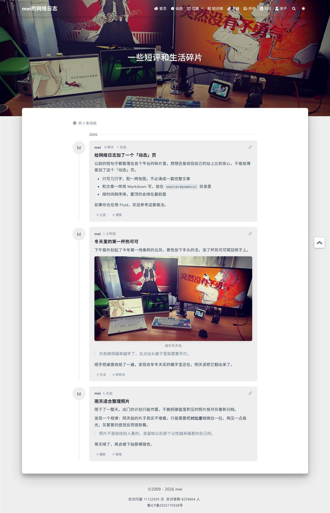

# 动态（Moments）

给 Fluid 主题加的一个「动态」页，用来发短评、生活记录和图片，不适合整理成长文的碎片内容都放在这里。

- 页面地址：<https://mei.lv/dynamics/>
- 和文章一样：一个动态 = 一个 Markdown 文件 + Front-matter，按日期倒序排列
- 支持完整的 Markdown 语法、主题的标签插件（如 ``、``）以及图片
- 支持分页、置顶、标签、暗色模式、移动端自适应
- 每条动态还会自动生成一个可分享的详情页（便于单独分享）



---

## 一、新建动态

### 方式 1：命令行（推荐）

```bash
# 标题默认作为文件名；也可以用 --slug 指定目录名
hexo dynamics "今天的晚霞"
hexo dynamics "今天的晚霞" --slug 2026-11-14-sunset
```

会在 `source/dynamics/<slug>/index.md` 生成一条动态，`<slug>` 默认取标题（中文标题会保留中文目录名）。
生成的文件长这样：

```markdown
---
title: "今天的晚霞"
date: 2026-11-14 18:30:00
tags:
---

```

标题会以 YAML 字符串写入，因此标题里带 `:`、`#` 等字符也不会破坏 Front-matter。
编辑正文后执行 `hexo generate` 即可。

### 方式 2：手动创建文件

在 `source/dynamics/` 目录下新建 Markdown 文件，两种存放方式都支持：

```text
source/dynamics/
├── 2026-11-14-sunset.md          # 方式 A：单文件
└── 2026-11-12-reading/           # 方式 B：文件夹 + 配图（推荐放图片时使用）
    ├── index.md
    └── photo.jpg
```

两种方式的 Front-matter 完全一致：

```yaml
---
title: 今天的晚霞        # 可选，不写则详情页以日期作为标题（列表页不显示标题）
date: 2026-11-14 18:30:00
tags:                    # 可选，仅作为动态的标签展示（不会进入 /tags/ 页面）
  - 生活
  - 摄影
top: true                # 可选，置顶
---
```

> 注意：**不要**创建 `source/dynamics/index.md`，`/dynamics/` 列表页由主题自动生成，创建该文件会冲突。

---

## 二、与文章逻辑的一致性

| | 文章（Post） | 动态（Page） |
| --- | --- | --- |
| 文件格式 | Markdown + Front-matter | 相同 |
| 时间排序 | 按 `date` 倒序 | 相同 |
| 图片/附件 | 站内绝对路径或文章同名资源目录 | 站内绝对路径或动态同目录相对路径 |
| 正文渲染 | hexo-renderer-marked + 主题标签插件 | 相同 |
| 出现位置 | 首页 / 归档 / 标签 / 分类 / RSS | 只出现在 `/dynamics/` 列表和各自的详情页 |
| 索引 | 搜索、RSS、sitemap | 搜索、sitemap（不含 RSS） |

动态存放在 `source/dynamics/` 而不是 `source/_posts/`，所以不会混进首页、归档、标签和 RSS；
但存储方式、Front-matter 写法、Markdown 渲染、图片资源处理都和文章保持一致。

---

## 三、图片与附件

### 站内绝对路径（和现有文章一样）

```markdown

```

把图片放在 `source/img/...` 下即可。

### 动态目录内的相对路径

图片和 `index.md` 放在同一目录，直接用相对路径引用：

```text
source/dynamics/2026-11-12-reading/
├── index.md
└── photo.jpg
```

```markdown

```

主题在渲染前会把相对路径补全为 `/dynamics/2026-11-12-reading/photo.jpg`，
详情页和列表页都能正常显示，附件链接（如 `[PDF](file.pdf)`）同理。
代码块（``` 或 ~~~ 围栏、4 空格缩进、``）、行内代码和脚注语法不会被路径补全影响。

### 多图排版

可以使用 Fluid 自带的 `groupimage` 标签：

```markdown




```

---

## 四、配置

配置位于 `_config.fluid.yml`（覆盖配置）中的 `dynamics` 段，主题自带默认值（`themes/fluid/_config.yml`）：

```yaml
dynamics:
  enable: true             # 是否启用动态列表页
  path: /dynamics/         # 列表页路径（详情页 URL 始终跟随文件所在目录，不受此项影响）
  per_page: 10             # 每页条数，0 表示不分页
  description: ''          # 页面顶部说明，支持 HTML

  banner_img: /img/index.jpg
  banner_img_height: 50
  banner_mask_alpha: 0.3

  note_banner_img: ''      # 单条动态详情页的头图，留空用 banner_img
  note_banner_img_height: 30

  title: '动态'
  subtitle: '一些短评和生活碎片'
  avatar: ''               # 留空使用 about.avatar
  author: ''               # 留空使用 about.name

  date_format: 'YYYY-MM-DD HH:mm'
```

导航菜单在 `_config.fluid.yml` 的 `navbar.menu` 中添加（已默认添加）：

```yaml
- { key: "dynamics", link: "/dynamics/", icon: "iconfont icon-clock-fill" }
```

关闭动态页：把 `dynamics.enable` 设为 `false`，列表页不再生成；动态文件本身仍可通过详情页访问，详情页的「返回动态」入口会自动隐藏。

---

## 五、实现文件

本功能是对本地 Fluid 主题的增强，涉及以下文件：

新增：

- `themes/fluid/layout/dynamics.ejs`：动态列表页布局
- `themes/fluid/layout/dynamics-note.ejs`：单条动态详情页布局
- `themes/fluid/layout/_partials/dynamics/note-card.ejs`：动态卡片
- `themes/fluid/scripts/generators/dynamics.js`：列表页分页 generator + 动态详情页布局套用
- `themes/fluid/scripts/filters/dynamics.js`：动态正文相对资源路径补全
- `themes/fluid/scripts/helpers/dynamics.js`：列表页正文资源路径处理
- `themes/fluid/scripts/console/dynamics.js`：`hexo dynamics` 命令
- `themes/fluid/source/css/_pages/_dynamics/dynamics.styl`：动态页样式
- `themes/fluid/source/js/dynamics.js`：相对时间显示

修改：

- `themes/fluid/source/css/_pages/pages.styl`（引入动态页样式）
- `themes/fluid/languages/*.yml`（菜单、空状态、相对时间等文案）
- `themes/fluid/source/xml/local-search.xml`（顺带修复了页面搜索结果的链接）
- `themes/fluid/_config.yml`（动态页默认配置）
- `_config.fluid.yml`（动态页配置 + 导航菜单）

示例内容：

- `source/dynamics/hello-dynamics/index.md`
- `source/dynamics/first-cocoa-of-winter/index.md`
- `source/dynamics/2026-11-09-rainy-day.md`

> 以后升级 Fluid 主题时，请保留上述新增/修改的文件；或者把 `themes/fluid` 中的这些文件合并到新主题里。

---

## 六、常见问题

**改了配置/样式后页面没变化？**

```bash
hexo clean && hexo generate
```

**动态没出现在列表里？**

- 确认文件在 `source/dynamics/` 目录下（不要在 `_posts/`）
- 确认 `dynamics.enable` 不是 `false`
- 确认没有创建 `source/dynamics/index.md`

**图片显示 404？**

- 用 `/img/...` 时确认文件在 `source/img/` 下
- 用相对路径时确认图片与 `index.md` 放在同一目录，并且路径大小写一致（Linux 服务器区分大小写）

**想调整列表每页数量？**

修改 `dynamics.per_page`，然后 `hexo clean && hexo generate`。

**想改标题/副标题/头像？**

修改 `dynamics.title`、`dynamics.subtitle`、`dynamics.avatar`、`dynamics.author`，留空时分别使用语言包、`about.avatar`、`about.name`。
